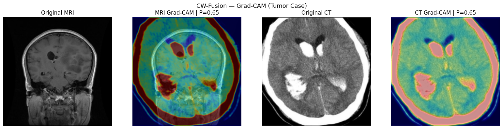
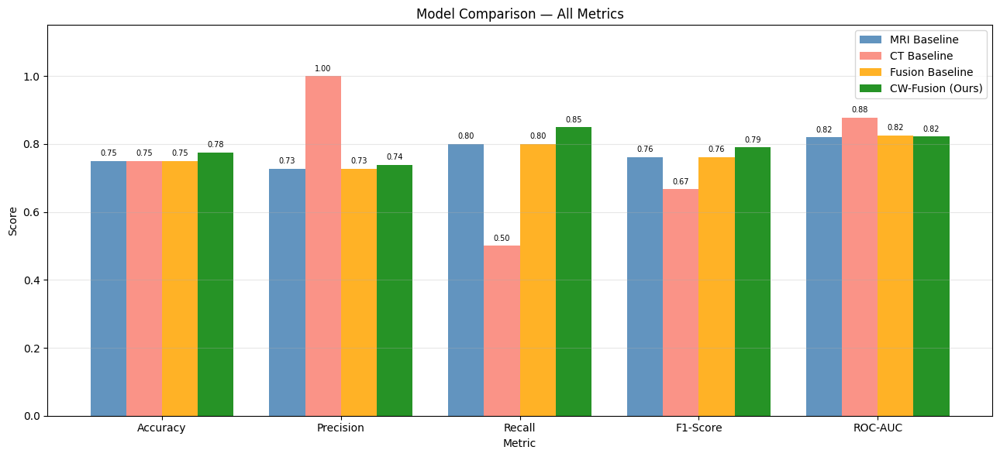
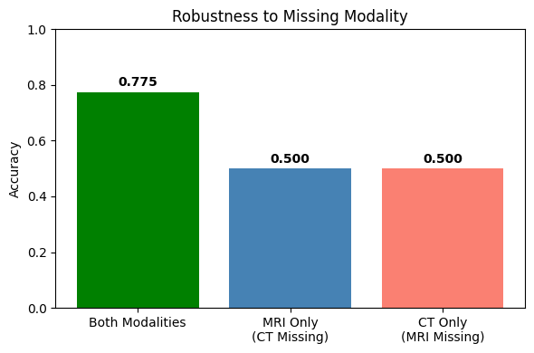

# Cross-Dataset Confidence-Weighted Fusion of MRI and CT for Brain Tumor Classification

A dual-branch CNN that combines brain **MRI** and head **CT** images for binary tumor classification. Each branch learns a **confidence score** that weights how much its features contribute to the final prediction. Because public datasets almost never contain MRI and CT from the *same* patient, the two modalities come from separate datasets and are paired by class label.

📄 Full write-up: [`report.pdf`](report.pdf)



## Results

All models are evaluated on held-out 40-image test sets (balanced: 20 tumor / 20 healthy).

| Model | Accuracy | Precision | Recall | F1 | ROC-AUC |
|---|---|---|---|---|---|
| MRI baseline (3-block CNN) | 0.750 | 0.727 | 0.800 | 0.762 | 0.820 |
| CT baseline (4-block CNN + BatchNorm) | 0.750 | 1.000 | 0.500 | 0.667 | **0.878** |
| Fusion baseline (feature concatenation) | 0.750 | 0.727 | 0.800 | 0.762 | 0.825 |
| **Confidence-weighted fusion (proposed)** | **0.775** | **0.739** | **0.850** | **0.791** | 0.823 |



## Method

**Data**
- **MRI:** 200 images (100 tumor / 100 healthy) from the Kaggle *Brain Tumor MRI* dataset.
- **CT:** 200 images (100 `yes` / 100 `no`) from the Kaggle *Head CT Images for Classification* dataset (`nipaanjum/head-ct-images-for-classification`).
- Each dataset gets its own stratified 60/20/20 split (train 120 / val 40 / test 40).
- Preprocessing: grayscale → 224×224 → scaled to [0, 1]. No augmentation, so differences between models come from architecture alone.

**Cross-dataset pairing.** Within each split, MRI and CT images with the same label are shuffled (seed 42) and paired one-to-one. Pairing happens separately inside train/val/test, so no test image is ever seen in training.

**Confidence-weighted fusion.** Each branch (2 conv blocks → global average pooling) produces a 64-d feature vector `f` and a scalar confidence `c ∈ (0, 1)` from a `Dense(1, sigmoid)` head:

```
f_fused = [ f_MRI · c_MRI  ||  f_CT · c_CT ]  →  Dense(128) → Dropout(0.4) → sigmoid
```

Confidences are learned end-to-end through the classification loss alone, with no extra supervision. **Modality dropout** (p = 0.3) zeroes one input during training to push each branch to learn on its own.

## Limitations

This was a course project on a small dataset, and these results should be read with that in mind:

- **No true patient pairing.** MRI and CT come from different patients, so the model can't learn anatomical correspondence between modalities, only label-level complementary signal.
- **Small test set.** With 40 test images, each prediction is worth 2.5%, so the gain over the baselines (75.0% → 77.5%) is a single image.
- **No missing-modality robustness.** Accuracy falls to 50% (chance) when either modality is zeroed at test time, so modality dropout did not produce a model that works on one modality alone.
- **Grad-CAM** shows the branches also attend to the skull boundary, not only the lesion, which suggests some reliance on non-pathological features.



**Possible next steps:** patient-paired MRI–CT data, data augmentation, pretrained backbones (e.g. ResNet), skull stripping, and cross-validation for more reliable estimates.

## Repository structure

```
notebooks/
  01_mri_preprocessing.ipynb        # load, resize, split MRI → .npz
  02_ct_preprocessing.ipynb         # download CT from Kaggle, split → .npz
  03_mri_baseline.ipynb             # MRI-only CNN + Grad-CAM
  04_ct_baseline.ipynb              # CT-only CNN
  05_fusion_baseline.ipynb          # dual-branch concatenation fusion
  06_confidence_weighted_fusion.ipynb  # proposed model, confidence weights, robustness, Grad-CAM
  07_model_comparison.ipynb         # evaluates all four models on the same test data
assets/                              # figures used in this README
report.pdf                           # full project report
```

## How to run

The notebooks are written for **Google Colab** with Google Drive mounted.

1. Download the datasets:
   - MRI: Kaggle *Brain Tumor MRI* dataset → zip it to `MyDrive/MRI/MRI.zip`
   - CT: downloaded automatically in notebook 02 via the Kaggle API (upload your `kaggle.json` when prompted)
2. Install dependencies (Colab already has most of them): `pip install -r requirements.txt`
3. Run the notebooks in order, `01` → `07`. Splits and trained models are saved to Drive, so later notebooks can be run independently.

## Tech stack

Python · TensorFlow / Keras · OpenCV · scikit-learn · NumPy · pandas · Matplotlib / Seaborn

---
Developed by **Mehreen Faisal**, AI Engineering, Bahçeşehir University, as part of AIN3002 Deep Learning for Image Processing.
